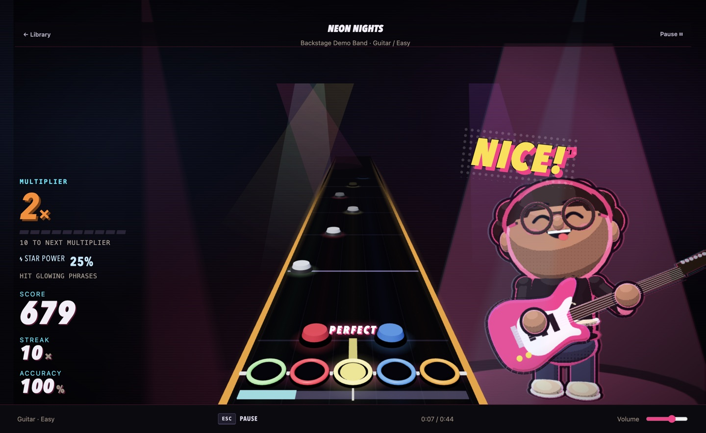
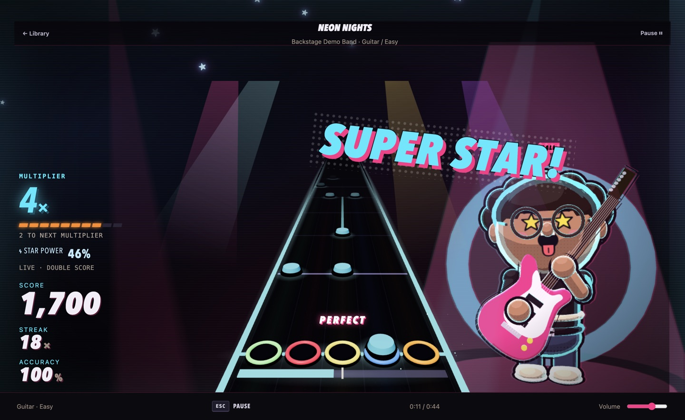

# The Agentic Engineering Doctrine
## Principles, Governance, and Dual-Repo Topology for AI-Driven Teams

**Written by Hanzala Rehan**

> *"Stochastic models require deterministic harnesses. When AI agents write code, the repository architecture itself must become the governor of truth."*

---

## 1. Executive Summary & Foundational Tenet

Traditional software development relies on human memory, peer review rituals, and implicit tribal knowledge. When autonomous and semi-autonomous AI agents (such as Claude Code, GitHub Copilot, Cursor, OpenAI Codex, Windsurf, Cline) enter the engineering loop, traditional practices break down due to four fundamental characteristics of Large Language Models:

1. **Context Pollution & Semantic Degeneracy:** As context windows fill with irrelevant operational code, mocks, and legacy reference files, an agent's reasoning fidelity degrades dramatically.
2. **Behavioral Drift across Diverse Tooling:** Different IDE agents and underlying models interpret implicit team standards inconsistently, hallucinating liberties when rules are not mechanically enforced at the prompt boundary.
3. **Stateless Ephemerality:** Agents operate across isolated conversational sessions without native cross-session persistent memory, causing redundant work, dropped assumptions, and broken handoffs.
4. **Sycophantic Compliance vs. Rigorous Verification:** Agents have a built-in incentive to declare victory based on superficial syntax checks or mock tests unless deterministic, fail-closed validation blocks them.

To overcome these failure modes, the **Backstage Architecture** establishes a rigorous engineering doctrine: **Dual-Repository Topology + Synchronized Multi-Agent Constitution + Deterministic Branch Promotion Gates + Explicit State Serialization.**

---

## 2. Industry Research Grounding: Anthropic & OpenAI Best Practices

This doctrine is grounded in and formalizes the engineering principles published by the leading AI research organizations:

### Anthropic: "Building Effective Agents" & Constitutional AI
- **Constitutional Guidance:** Anthropic's *Constitutional AI* demonstrates that models adhere best to self-governing principles when constraints are stated as foundational axioms rather than granular negative rules.
- **Orchestrator-Workers & Context Management:** In *Building Effective Agents* (Anthropic Research, 2024), Anthropic emphasizes keeping the "lead orchestrator" context clean and delegating execution to task-isolated sub-agents. Mixing high-level architectural decisions with deep implementation churn degrades token efficiency and attention focus.
- **Pushing Back on Infeasible Requests:** Effective agent prompts must explicitly authorize and compel the model to push back against brittle architecture, unsafe assumptions, and shallow workarounds rather than passively complying.

### OpenAI: "Practices for Governing Agentic AI" & Harness Design
- **Deterministic Harnesses Around Probabilistic Engines:** OpenAI's governance framework emphasizes that safety and reliability cannot rely on model alignment alone. Bounding systems (sandboxing, static analysis, immutable validation gates) must enforce non-negotiable boundaries.
- **Fail-Closed Verification:** A task is never "done" because the model predicts it is done; it is done only when external, machine-verifiable evidence (`acceptance.json`, test exit codes, hardware logs) proves compliance.
- **Separation of Policy and Execution:** Business objectives, release approvals, and compliance requirements must live in a protected policy domain separate from high-churn development workspaces.

---

## 3. The 4 Pillars of the Backstage Agentic Architecture

```
┌────────────────────────────────────────────────────────────────────────┐
│                        CANONICAL SPECS REPO                            │
│                        (e.g., backstage-specs)                         │
│                                                                        │
│  [business/]       [governance/]        [openspec/]      [releases/]   │
│  • Product Brief   • Constitution.md    • Proposals      • Release     │
│  • Decision Log    • Components.json    • Tasks & Specs    Reports     │
│  • Runtime Specs   • Adapters.json      • Handoffs       • Evidence    │
└───────────────────────────────────┬────────────────────────────────────┘
                                    │
                         npm run agents:install
                         (SHA-256 Drift Guard)
                                    │
                                    ▼
┌────────────────────────────────────────────────────────────────────────┐
│                     CODE IMPLEMENTATION REPO                           │
│                     (e.g., Backstage)                                  │
│                                                                        │
│   starter (reference) ──► develop (integration)                        │
│                                 │                                      │
│                                 ▼ (check_promotion.py gate)            │
│                              stage (acceptance / hardware)             │
│                                 │                                      │
│                                 ▼ (fail-closed release report gate)    │
│                               main (verified production)               │
└────────────────────────────────────────────────────────────────────────┘
```

### Pillar 1: Dual-Repository Topology (Preventing Context Pollution)
- **The Problem:** Placing comprehensive specifications, user stories, architectural decision records (ADRs), and compliance rules in the same repository as 50,000 lines of source code floods the agent's context window with irrelevant tokens. The agent confuses historical reference code with active requirements.
- **The Solution:**
  - **The Meta/Specs Repo (`<project>-specs`):** Houses business intent, OpenSpec changes, active task lists, ADRs, release sign-offs, and the master agent constitution.
  - **The Implementation Repo (`<project>`):** Houses pure source code, build scripts, tests, and local runtime configuration.
  - **The Linkage:** Both repositories share a single **kebab-case feature ID** (e.g., `web-desktop-foundation`). The code repository's root `README.md` points explicitly to the canonical planning home on the `meta` branch.

### Pillar 2: The Universal Synchronized Constitution (Drift Defense)
- **The Problem:** Different developers and agents use different IDEs (Cursor uses `.cursor/rules/*.mdc`, Claude Code uses `CLAUDE.md`, GitHub Copilot uses `.github/copilot-instructions.md`, Cline uses `.clinerules`, Codex uses `AGENTS.md`). Maintaining separate instruction files manually guarantees rules will diverge and be violated.
- **The Solution:**
  - One single canonical source of truth: `governance/constitution.md`.
  - Machine-readable adapters: `governance/adapters.json` mapping all 40+ supported agent configuration locations.
  - Automated synchronization (`npm run agents:sync` / `agents:install`): Injects managed blocks bounded by:
    ```markdown
    <!-- CONSTITUTION:START -->
    ... Generated content with Source SHA-256 ...
    <!-- CONSTITUTION:END -->
    ```
  - **Zero Loss of Local Customizations:** Content outside the managed block is preserved bit-for-bit.
  - **Instruction Drift Detection:** CI runs `agents:install --check` which recalculates SHA-256 hashes and fails if any agent configuration was manually edited or drifted out of sync.

### Pillar 3: Deterministic Branch Lifecycle & Fail-Closed Gatekeepers
- **The Branch Hierarchy:**
  ```
  feature/<change-id> ──► develop ──► stage ──► main
  ```
- **The Rules:**
  1. **No Direct Promotion:** Never promote directly from a feature branch or `develop` to `main`.
  2. **Stage Gate:** `stage` receives candidate builds from `develop` only after automated test suites and build gates pass. Stage is dedicated to hardware, performance, and recovery testing.
  3. **Main Gate:** `main` holds strictly production-verified releases. Every promotion to `main` must originate from `stage`.
  4. **The Promotion Gatekeeper (`check_promotion.py`):**
     - Evaluates candidate commits against `release/acceptance.json`.
     - Validates that the commit tested in `acceptance.json` is an exact ancestor of the candidate SHA.
     - Confirms that zero code/asset changes occurred between the tested commit and the release candidate.
     - Requires an explicit link to an owner-approved release report in `meta`.
     - Enforces named reviewer and rollback procedures for `main`.
  5. **Core Philosophy on Human Authority:** *User authorization can change scope or defer requirements, but user authorization can never bypass, fake, or waive test and hardware verification results.*

### Pillar 4: State Serialization & Multi-Agent Handoffs
- **The Problem:** LLM sessions are ephemeral. When Agent A finishes turn 1 and Agent B takes over on turn 2, Agent B lacks the intermediate reasoning, leading to regressions, hallucinated decisions, or circular refactoring.
- **The Solution:** Mandatory serialization of work state into `handoff.md` within the active feature change folder:
  - **Current Phase:** Proposing / Implementing / Validating / Blocked.
  - **Active Agent & Tooling:** e.g., Claude 3.7 Sonnet via Copilot CLI.
  - **Code Checkouts & Commits:** Exact SHAs and branches touched.
  - **Decisions Made:** Explicit rationale for deviations from starter/reference code.
  - **Test & Hardware Evidence:** Concrete command outputs and test logs.
  - **Blockers & Deferred Work:** What cannot be completed and why.
  - **Next Immediate Action:** Specific instructions for the incoming agent.

---

## 4. Engineering & Design Judgment Rules for Agents

Every agent operating under this constitution must enforce the following non-negotiable behaviors:

| Principle | Anti-Pattern (What Agents Typically Do) | Constitutional Standard (What Backstage Agents Must Do) |
|---|---|---|
| **Technical Honesty** | "Everything looks great! I fixed the bug and all tests pass (using mocks)." | Report exact command outputs; explicitly state what hardware or end-to-end checks remain unverified. |
| **Push-Back Duty** | Blindly implements a requested quick fix that introduces a race condition or security vulnerability. | Refuse brittle architecture; explain the concrete failure mode, user consequence, and propose a robust alternative. |
| **Reference vs. Requirement** | Copies legacy bugs and proprietary dependencies from reference starter code. | Treat starter code solely as historical inspiration; require explicit specifications before introducing dependencies. |
| **Atomic Delivery** | Dumps partial, untested files or unmigrated database states into the main branch. | Keep background assets, caches, and partial conversions isolated; publish atomically only upon validation. |
| **Customer vs. Operator Boundary** | Exposes debug toggles or OS recovery tools in customer-facing user interfaces. | Strictly sandbox operator diagnostics behind authenticated, isolated operational views. |

---

## 5. Production Case Study: Backstage Real-World Implementation

The validity of this doctrine is proven in the production architecture of **[Backstage](https://github.com/Hanzala-plyance/backstage)** and its companion specifications repository **[backstage-specs](https://github.com/Hanzala-plyance/backstage-specs)**.

<p align="center">
  
</p>

### Real-World Architectural Samples:

1. **Separation of Concerns:**
   - **Canonical Specs:** [`backstage-specs/meta`](https://github.com/Hanzala-plyance/backstage-specs/tree/meta) holds all product intent, architectural decisions ([`business/decisions.md`](https://github.com/Hanzala-plyance/backstage-specs/blob/meta/business/decisions.md)), and formal task definitions ([`openspec/changes/`](https://github.com/Hanzala-plyance/backstage-specs/tree/meta/openspec/changes)).
   - **Code Checkout:** [`Hanzala-plyance/backstage`](https://github.com/Hanzala-plyance/backstage) contains pure implementation code without specification noise.

2. **Scoped Component Boundaries:**
   - **Web / Electron Desktop:** [`desktop/`](https://github.com/Hanzala-plyance/backstage/tree/develop/desktop) — Sandboxed IPC and React/Three.js game loop.
   - **Controller Hardware Bridge:** [`mac-riff/`](https://github.com/Hanzala-plyance/backstage/tree/develop/mac-riff) — Native macOS low-latency gamepad and guitar driver.
   - **Stem Audio Converter:** [`song-converter/`](https://github.com/Hanzala-plyance/backstage/tree/develop/song-converter) — Python AI stem separator and chart generation pipeline.

3. **Deterministic Gatekeeper:**
   - The production gatekeeper [`scripts/check_promotion.py`](https://github.com/Hanzala-plyance/backstage/blob/develop/scripts/check_promotion.py) verifies git ancestor history against [`release/acceptance.json`](https://github.com/Hanzala-plyance/backstage/blob/develop/release/acceptance.json).

| Song Library & Chart Management | Star Power FX & Multiplier Scoring |
|:---:|:---:|
|  |  |
| *Atomic song ingestion via `song-converter`* | *Real-time Web Audio scoring loop in `desktop`* |

---

## 6. Summary Checklist for New Teams

- [ ] Split specifications and planning into a dedicated `*-specs` repository on branch `meta`.
- [ ] Initialize `governance/constitution.md` with non-negotiable operational tenets.
- [ ] Deploy `agents:sync` with managed comment markers across all IDE agent configuration files.
- [ ] Enforce feature branches branching off `develop`, promoting through `stage`, and gating into `main`.
- [ ] Implement a deterministic gatekeeper script (`check_promotion.py`) tied to `acceptance.json`.
- [ ] Standardize the multi-agent `handoff.md` protocol for every feature change.
- [ ] Run continuous drift detection in CI to prevent unauthorized prompt alterations.
